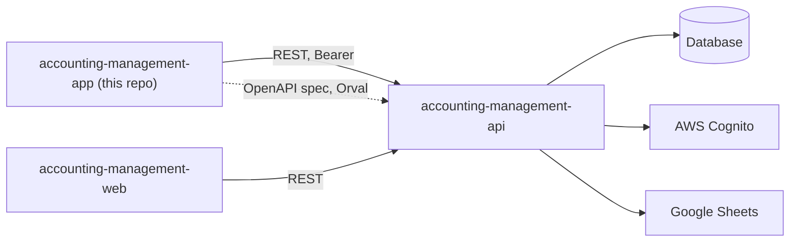
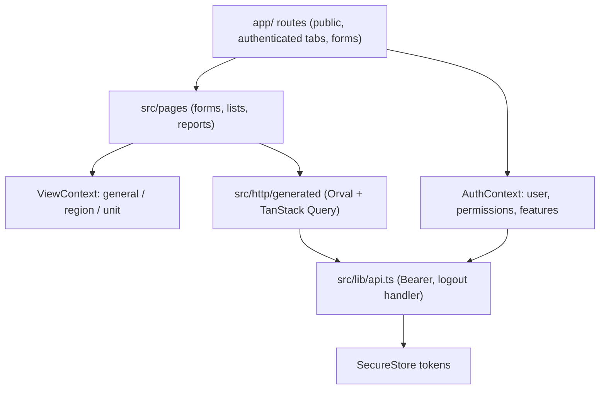

# Accounting Management App

Expo / React Native app for field users to record preparations, sessions and stock for their unit, view consolidated reports, and optionally export them to Google Sheets.

Status: working client built for a private organisation; not published as an open product. Single initial commit, no automated tests, not verified against a production backend from this repository.

## What it does

- Email sign-up, confirmation and sign-in against the backend; tokens in SecureStore (`app/public/`, `src/context/auth-context.tsx`, `src/lib/api.ts`).
- Multi-step form for preparations and forms for sessions and stock entries, validated with Zod and React Hook Form (`src/pages/preparos`, `sessoes`, `vegetal`).
- Reports tab with period picker and metric cards for the selected scope (`src/pages/relatorios`).
- Scope switcher (general, region, unit) driven by the user's permissions (`src/pages/region-selector`, `src/context/view-context.tsx`, `src/@types/permissions.ts`).
- Per-unit and per-user feature flags: stock tab and integrations tab only appear when enabled (`src/context/auth-context.tsx`).
- Pending-access screen for accounts not yet approved (`app/authenticated/pending.tsx`).
- Optional Google Sheets export of preparations, sessions and results via the backend (`src/components/google-sheets/`).
- In-app update prompt and per-environment backend URL.

## Architecture





- `app/` is routing only; `src/pages` holds screen logic and forms.
- Visibility scope is chosen client-side but enforced by the API; the view context only sends the selected scope as query parameters.
- The API client is generated and not committed (`src/http` is git-ignored); generate it before the first run.

## Key engineering decisions

- Semver in `package.json` is the single source for Android `versionCode` and the iOS marketing version (`app.config.js`, `scripts/bump-version.mjs`).
- Android release signing is injected by an Expo config plugin, so native folders stay generated by prebuild (`plugins/withAndroidReleaseSigning.js`, `support-files/build.gradle`).
- A single Axios instance with a logout handler that avoids repeated logouts on concurrent 401s (`src/lib/api.ts`).
- Feature flags and permissions come from the user profile, not build variants (`src/context/auth-context.tsx`).
- Client generated from the backend OpenAPI spec (`orval.config.ts`).

## Tech stack

Expo 54, React Native 0.81, Expo Router, NativeWind, TanStack Query, React Hook Form, Zod, Axios, Orval, Biome, EAS and Codemagic build configs.

## Getting started

Prerequisites: Node 20+, Yarn, Android Studio or Xcode, a running backend ([accounting-management-api](https://github.com/mkwitko/accounting-management-api)).

```bash
yarn install
cp .env.example .env
npx orval          # writes src/http/generated from $EXPO_PUBLIC_BACKEND/docs/json
yarn start
```

| Variable | Purpose |
| --- | --- |
| `EXPO_PUBLIC_BACKEND` | Base URL of the backend API (also the Orval spec source) |
| `EXPO_OAUTH_CLIENT_ID` | OAuth client id for the optional Google integration |

Builds use EAS (`eas.json`) or Codemagic (`codemagic.yaml`); set the Apple id and signing references in your own account. Android signing keys are not included.

## Testing

No test files. `yarn lint` is available.

## Project structure

```text
app/            Expo Router routes (public auth, authenticated tabs and forms)
src/pages/      Screen logic: preparations, sessions, stock, reports, region selector
src/components/ UI, reports, Google Sheets integration
src/context/    Auth and view providers
src/lib/        Axios instance, query client, cache
plugins/        Android release signing config plugin
```

## Related repositories

- [accounting-management-api](https://github.com/mkwitko/accounting-management-api): backend API.
- [accounting-management-web](https://github.com/mkwitko/accounting-management-web): read-only admin panel.

## License

All rights reserved. Source available for portfolio review.
