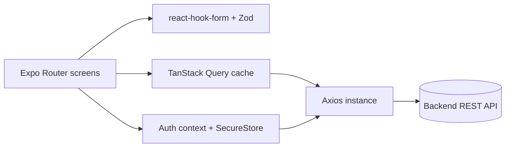

# udv-sus-mobile

Mobile client (Expo / React Native) for recording preparation, inventory and session data of a sustainability-tracking system, backed by a separate REST API.

Status: working client built for a private organization; not published as an open product. No tests beyond the Jest preset.

## What it does

- Email sign-up, confirmation and sign-in against the backend.
- Forms for preparations, sessions and vegetal stock entries, validated with Zod.
- Stock and report tabs, region picker, and a view switcher.
- Optional Google Sheets integration screen.
- In-app update prompt and per-environment backend URL.

## Architecture



- `app/`: file-based routes split into `public/` (auth) and `authenticated/` (tabs and forms).
- `src/lib/api.ts`: single Axios instance, attaches the access token.
- `src/context/`: auth and view state.

## Key decisions

- Semver in `package.json` is the single source for Android `versionCode` and iOS marketing version (`app.config.js`, `scripts/bump-version.mjs`).
- Android release signing is injected by an Expo config plugin (`plugins/withAndroidReleaseSigning.js`); native folders are generated by prebuild and not committed.
- API client is generated from the backend OpenAPI spec with Orval (`orval.config.ts`).

## Tech stack

Expo 54, React Native, Expo Router, NativeWind, TanStack Query, React Hook Form, Zod, Axios, Orval, Biome.

## Getting started

Prerequisites: Node 20+, Yarn, Android Studio or Xcode for native runs.

```bash
yarn install
cp .env.example .env
yarn start
```

| Variable | Purpose |
| --- | --- |
| `EXPO_PUBLIC_BACKEND` | Base URL of the backend API |
| `EXPO_OAUTH_CLIENT_ID` | OAuth client id for the optional integration |

Builds use EAS (`eas.json`) or Codemagic (`codemagic.yaml`; set `APP_STORE_APPLE_ID` and the signing references in your own account). Android signing keys are not included.

## Testing

Jest preset only (`yarn test`); no test files yet.

## License

All rights reserved. Source available for portfolio review.
